<p align="center">
  <a href="https://pub.dev/packages/system_date_time_format"></a>
</p>
<h2 align="center">
  A plugin for getting date & time format from device system settings.
</h2>

<p align="center">
  <a href="https://pub.dev/packages/system_date_time_format">
    
  </a>
  <a href="https://github.com/Nikoro/system_date_time_format/actions">
    
  </a>
  <a href="https://codecov.io/gh/Nikoro/system_date_time_format">
    
  </a>
  <a href="https://opensource.org/licenses/MIT">
    
  </a>
    
    
    
    
    
    
</p>

---
## Why system_date_time_format?

Flutter does not support retrieving date and time format patterns based on the user's system
settings out of the box. However, you can use the `system_date_time_format` plugin to get 
date and time format patterns for consistent formatting in your Flutter app with ease:

```dart
final datePattern = SystemDateTimeFormat.datePattern;
print(datePattern); // e.g. "M/d/yy"
```

### Examples
| iOS (Region: United States 🇺🇸)                                                                                 | Result                                                                                                        |
| -------------------------------------------------------------------------------------------------------------- | ------------------------------------------------------------------------------------------------------------- |
| 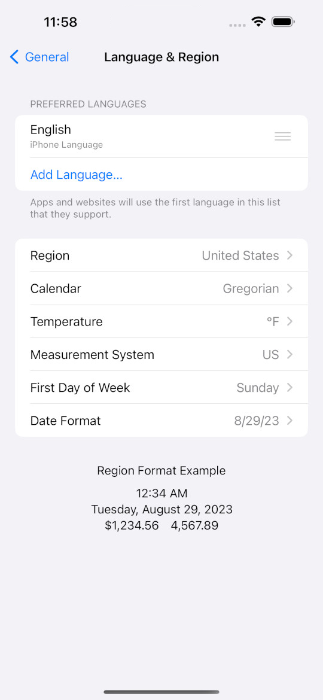            | 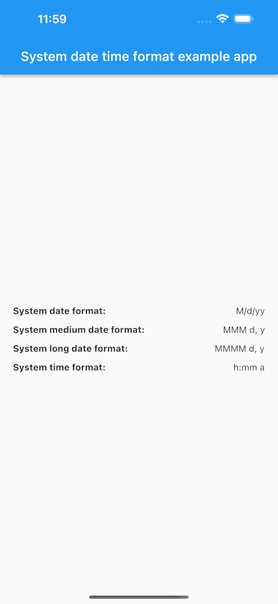         |

| Android (Region: United Kingdom 🇬🇧)                                                                            | Result                                                                                                        |
| -------------------------------------------------------------------------------------------------------------- | ------------------------------------------------------------------------------------------------------------- |
| 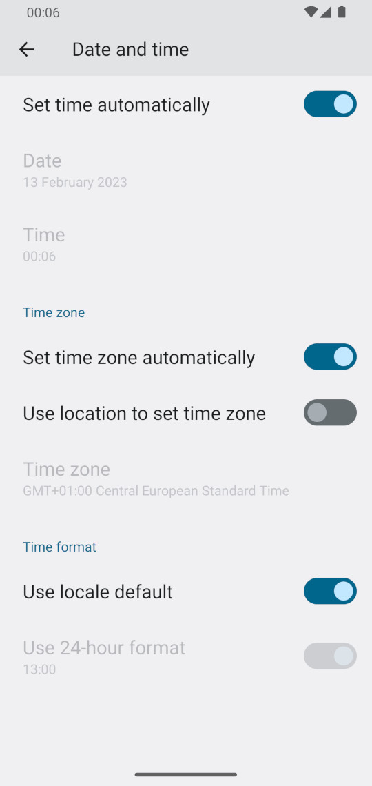    | 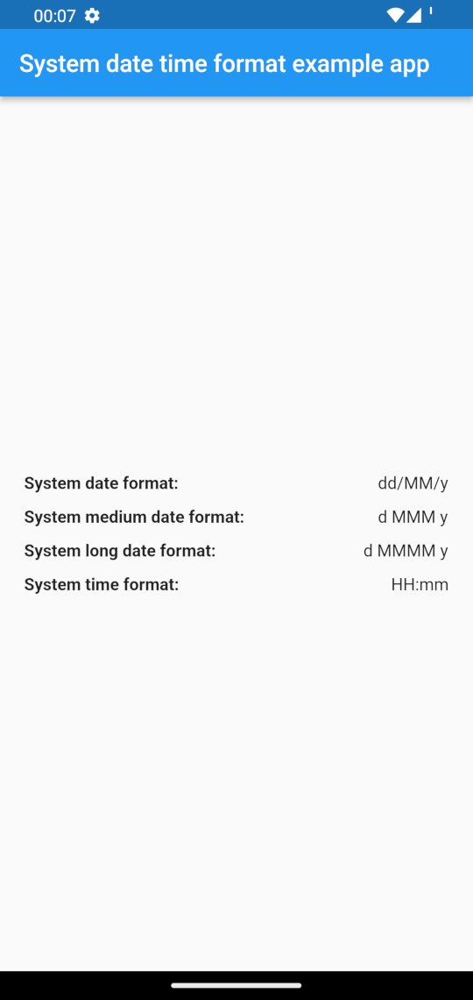 |

| macOS (Region: Poland 🇵🇱)                                                                                      | Result                                                                                                        |
| -------------------------------------------------------------------------------------------------------------- | ------------------------------------------------------------------------------------------------------------- |
| 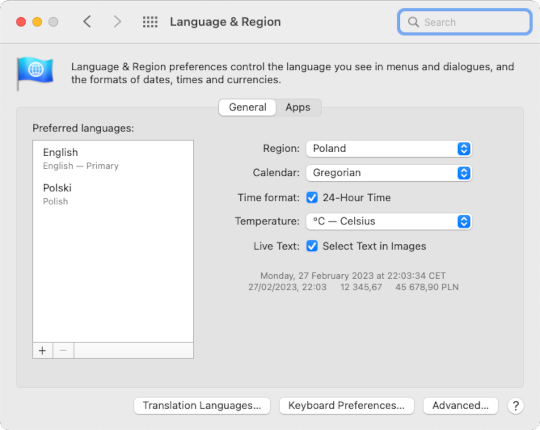        | 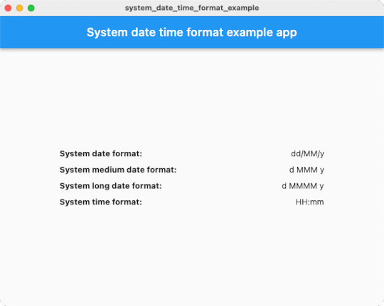     |

| windows (Region: United States 🇺🇸)                                                                             | Result                                                                                                        |
| -------------------------------------------------------------------------------------------------------------- | ------------------------------------------------------------------------------------------------------------- |
| 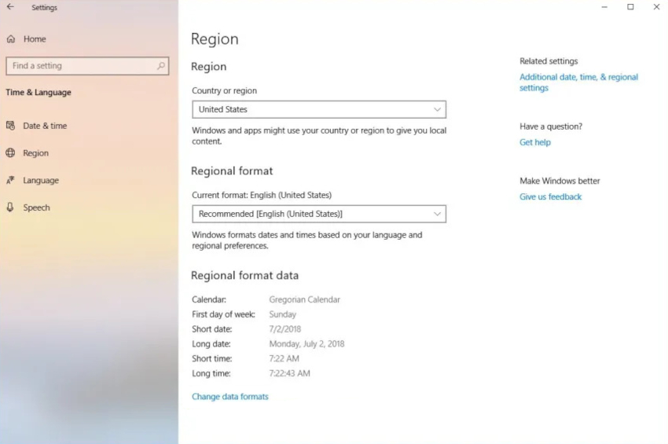    | 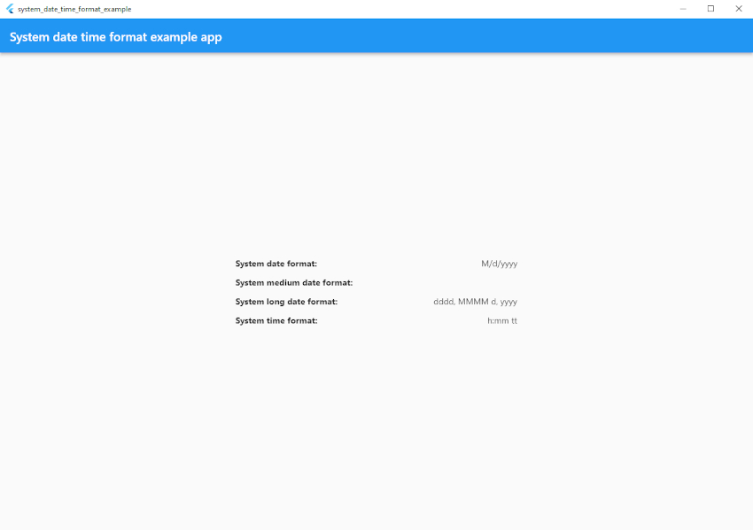 |

| linux (Region: United States 🇺🇸)                                                                      | Result                                                                                                    |
|---------------------------------------------------------------------------------------------------------|-----------------------------------------------------------------------------------------------------------|
| 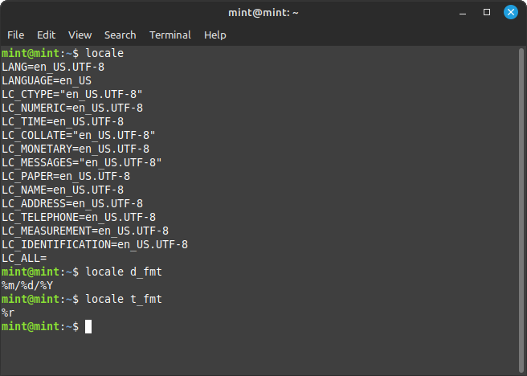 | 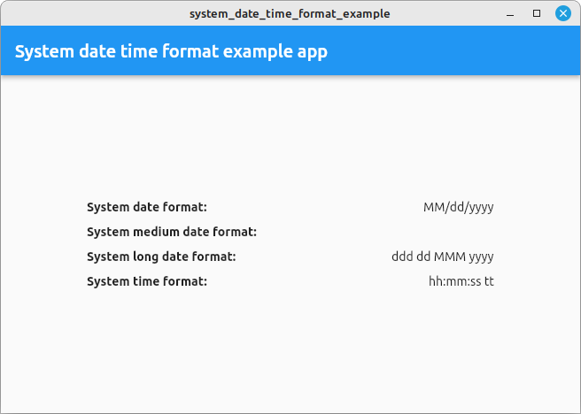 |

| web (Region: Poland 🇵🇱)                                                                                                                                                                                                         |
|-----------------------------------------------------------------------------------------------------------------------------------------------------------------------------------------------------------------------------------|
| 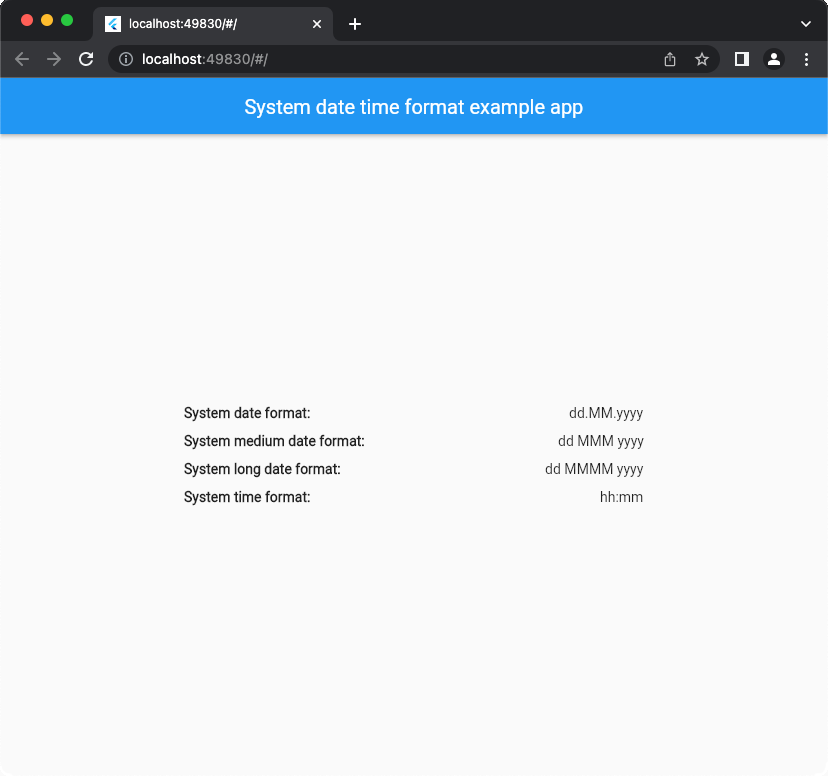

## Usage

Read a pattern directly from the current system settings. Medium and full date patterns return `null` on Windows and Linux.

```dart
import 'package:system_date_time_format/system_date_time_format.dart';

void main() {
  final date = SystemDateTimeFormat.datePattern;             // e.g. "M/d/yy"
  final mediumDate = SystemDateTimeFormat.mediumDatePattern; // e.g. "MMM d, y"
  final longDate = SystemDateTimeFormat.longDatePattern;     // e.g. "MMMM d, y"
  final fullDate = SystemDateTimeFormat.fullDatePattern;     // e.g. "EEEE, MMMM d, y"
  final time = SystemDateTimeFormat.timePattern;             // e.g. "HH:mm"
}
```

### Migrating from 1.x

See the [step-by-step migration guide](CHANGELOG.md#migrating-an-app-from-1x).

Replace `await SystemDateTimeFormat().getDatePattern()` with `SystemDateTimeFormat.datePattern`. The other format methods follow the same naming convention. Replace calls to `getAllPatterns()` and `SystemDateTimeFormat.of(context)` with the individual getters you need. Remove the `SDTFScope` wrapper.

Each getter reads the current settings synchronously. A widget that reads patterns in `build()` picks up changes on its next rebuild.

### Linux

Linux reads short date and time patterns from the active `LC_TIME` locale. For the long date, it uses the ICU date-only style for that locale. Install the ICU development package on the Linux build machine (for example, `sudo apt install libicu-dev` on Ubuntu or Debian). The application requires the matching ICU runtime libraries.

### Web

Web getters use the browser’s locale and hour cycle. A getter returns `null` when the browser reports a field that has no matching pattern, such as a named year in the Chinese calendar. Load the JavaScript asset in `index.html` before Flutter starts.

**From version 1.3.1 and above**, the preferred way is to use the local asset:
```html
<script src="./assets/packages/system_date_time_format/web/system_date_time_format.min.js"></script>
```

Alternatively, you can still use the CDN link:
```html
<script src="https://cdn.jsdelivr.net/gh/Nikoro/system_date_time_format@main/web/system_date_time_format.min.js"></script>
```

index.html

```html
<!DOCTYPE html>
<html>
<head>
    <!--...-->
    <script src="./assets/packages/system_date_time_format/web/system_date_time_format.min.js"></script>
</head>
<body>
<!--...-->
</body>
</html>
```

### Testing

Mocktail stubs instance members. To test code that reads a static format getter, pass the consuming widget a value or a reader owned by your app. In `example_with_tests`, the production `DeviceFormats.time` getter calls `SystemDateTimeFormat.timePattern`. A widget test supplies a mock instance:

```dart
final formats = MockDeviceFormats();
when(() => formats.time).thenReturn('HH:mm');
await tester.pumpWidget(App(formats: formats));
expect(find.text('HH:mm'), findsOneWidget);
```

The example also tests how the app displays unavailable date styles. [App adapter](example_with_tests/lib/device_formats.dart) · [Widget tests](example_with_tests/test/app_test.dart)
